# 🥑 Avocado Ripening Prediction


## Project Overview

This project is a Deep Learning solution designed to predict the ripening stage of avocados based on image data. It leverages modern MLOps practices, including **Prefect** for orchestration, **MLFlow** for experiment tracking and model registry, and **Docker** for containerization.

## System Architecture
The following diagram illustrates the end-to-end MLOps workflow, separating the **Application Lifecycle (CI/CD)** from the **Model Lifecycle (CT)**. It highlights how code changes trigger deployments, while model architecture changes trigger retraining on Kaggle.

```mermaid
graph LR
    classDef cicd fill:#ffecb3,stroke:#f39c12,stroke-width:2px,rx:5,ry:5,color:#000;
    classDef runner fill:#e3f2fd,stroke:#1565c0,stroke-width:2px,rx:5,ry:5,stroke-dasharray: 5 5,color:#000;
    classDef dsStage fill:#d4e6f1,stroke:#5D6D7E,stroke-width:2px,rx:5,ry:5,color:#000;
    classDef pipelineStage fill:#d7bde2,stroke:#8e44ad,stroke-width:2px,rx:5,ry:5,color:#000;
    classDef dataStore fill:#a9dfbf,stroke:#27ae60,stroke-width:2px,rx:5,ry:5,shape:cyl,color:#000;
    classDef trigger fill:#fad7a0,stroke:#e67e22,stroke-width:2px,rx:15,ry:15,stroke-dasharray: 5 5,color:#000;
    classDef service fill:#f5cba7,stroke:#d35400,stroke-width:2px,rx:15,ry:15,color:#000;
    classDef decision fill:#fff,stroke:#8e44ad,stroke-width:2px,rx:5,ry:5,shape:diamond,color:#000;
    classDef future fill:#eee,stroke:#bbb,stroke-width:2px,rx:5,ry:5,stroke-dasharray: 5 5,color:#000;

    %% --- CI/CD PIPELINE ---
    subgraph "CI/CD Pipeline (GitHub Actions)"
        subgraph Padding2 [" "]
            GitPush("User Pushes Code"):::trigger
        end
        style Padding2 fill:none,stroke:none
        PathFilter{"What changed?"}:::decision
        
        %% CI Workflow
        subgraph "CI Workflow"
            PyTest("🧪 Run Unit Tests<br/>(Pytest)"):::cicd
        end

        %% CD Workflow (Self-Hosted)
        subgraph "CD Workflow (Self-Hosted)"
            BuildPush("🔨 Build & Push Image<br/>(Docker Hub)"):::cicd
            UpdateConfig("📝 Update Config<br/>(Inject .env & Compose)"):::cicd
            ComposeUp("🚀 Deploy<br/>(Compose Up --force-recreate)"):::cicd
        end
        
        ImageRepo[(Docker Hub)]:::dataStore
    end

    %% --- DATA SCIENCE & CT PIPELINE ---
    subgraph "DS Development & Automated Pipelines (CI/CT)"
        
        subgraph Padding [" "]
            direction TB
            DataTrigger("Trigger: New Data / Manual"):::trigger
        end
        style Padding fill:none,stroke:none

        subgraph "Processing & Training"
            Preprocessing(Data Preprocessing):::pipelineStage
            Training("Model Training <br/>(Kaggle)"):::pipelineStage
        end

        Registry[(MLflow Model Registry)]:::dataStore
        Evaluation{"Model Evaluation<br/>(vs Others)"}:::decision
    end

    %% --- OPERATIONS ---
    subgraph "ML Operations (Inference)"
        PredictionService("ML Prediction Service<br/>(FastAPI)"):::service
        Monitoring("Future: Monitoring<br/>(Prometheus)"):::future
    end

    %% CONNECTIONS
    
    %% 1. Code Flow
    GitPush --> PathFilter
    PathFilter -- "App Code" --> PyTest
    PyTest --> BuildPush
    
    %% 2. Deployment Details
    BuildPush --> ImageRepo
    BuildPush --> UpdateConfig
    UpdateConfig --> ComposeUp
    ComposeUp -.-> PredictionService

    %% 3. The Cross-Over (Model Code -> Training)
    PathFilter -. "Model Code" .-> Training

    %% 4. Data Science Flow
    DataTrigger --> Preprocessing
    Preprocessing --> Training
    Training --> Registry
    Registry --> Evaluation

    %% 5. Promotion Flow
    Evaluation -- "Improved" --> PredictionService
    Evaluation -- "Not Improved" --> End(("End")):::future
    
    %% Feedback
    PredictionService -.- Monitoring
    Monitoring -.- DataTrigger
    
    %% Layout Hint
    GitPush ~~~ DataTrigger

    %% STYLING
    linkStyle 7 stroke:red,stroke-width:3px,stroke-dasharray: 5 5;
```


## Tech Stack

* **Python**: Primary programming language.
* **TensorFlow/Keras**: Deep Learning framework for model development.
* **Prefect**: Workflow orchestration for data processing, training, and deployment pipelines.
* **MLFlow**: Platform for managing the MLOps lifecycle (experiment tracking, model registry).
* **FastAPI**: For building the prediction API.
* **Docker**: Containerization for reproducible environments.
* **AWS S3 & RDS**: Cloud storage for artifacts and metadata.

## Project Organization

```
.
├── .dockerignore
├── .gitattributes
├── .gitignore
├── .vscode/
├── app/
│   ├── __init__.py
│   ├── main.py                <- FastAPI application entry point
│   └── ...
├── docker-compose.override.yaml <- Development overrides (Local)
├── docker-compose.yaml          <- Base/Production Docker composition
├── Dockerfile
├── Makefile
├── prefect.yaml                 <- Prefect deployment configuration
├── data/                        <- Data directory
├── mlartifacts/                 <- Local artifact storage
├── mlflow/                      <- MLFlow server configuration
├── models/                      <- Local model storage
├── notebooks/                   <- Jupyter notebooks for exploration & training
├── pipelines/
│   ├── flows.py                 <- Prefect flows and tasks definition
│   └── ...
└── src/                         <- Shared source code
```

## Core Components

### 🚀 Inference API (`avocado-api`)

The API is built with **FastAPI** and serves the trained model.

* **Model Loading**: On startup, it connects to the MLFlow Model Registry and downloads the model tagged with the `@champion` alias.
* **Endpoints**:
    * `POST /predict`: Accepts an image (file or URL) and storage condition to predict ripeness days.
    * `POST /reload-model`: Triggers a hot-reload of the model from MLFlow without restarting the container. This is called automatically by the Prefect pipeline after a successful model promotion.
    * `GET /health`: Checks if the model is loaded and responsive.

### 🧪 MLFlow Server (`mlflow`)

Acts as the central hub for the machine learning lifecycle.

* **Experiment Tracking**: Logs parameters, metrics, and artifacts from training runs.
* **Model Registry**: Manages model versions and stages. Implements a **Champion/Challenger** strategy where the best performing model is aliased as `champion` for production use.
* **Storage**: Uses AWS S3 for artifacts (images, models) and a SQL database (PostgreSQL/MySQL) for backend storage.

### ⚡ Prefect Pipelines (`prefect-server`, `prefect-worker`)

**Prefect** orchestrates the end-to-end MLOps workflow defined in `pipelines/flows.py`. The primary flow `test_flow` executes the following tasks:

1.  **`fetch_data`**: Downloads the raw dataset from an OCI/AWS S3 bucket and caches it locally.
2.  **`preprocess_data`**: Cleans data, computes over-ripeness metrics, filters images, and prepares the final dataset.
3.  **`upload_preprocessed_data`**: Uploads the processed dataset to **Kaggle Datasets** to be used by the training kernel.
4.  **`train_model`**:
    * Injects hyperparameters and configuration into a **Kaggle Notebook** template.
    * Pushes the kernel to Kaggle to run on their GPU infrastructure.
    * Polls the kernel status until completion.
5.  **`evaluate_model`**:
    * Compares the new model ("Challenger") against the current "Champion" in MLFlow.
    * If the Challenger has a lower validation loss, it is promoted to `champion` in the registry.
6.  **`deploy_model`**: If a promotion occurred, this task calls the API's `/reload-model` endpoint to update the live service.

## Infrastructure & Configuration

The project uses **Docker Compose** to manage services. The configuration is split into two files for flexibility.

### 1. `docker-compose.yaml` (Production / Base)

Defines the core services for a stable, production-like environment:

* **`postgres` & `redis`**: Backing services for Prefect.
* **`prefect-server` & `prefect-worker`**: Runs the Prefect UI and executes flow deployments.
* **`avocado-api`**: The production inference API.
* **`mlflow`**: The MLFlow server connected to AWS S3 and a production DB.

### 2. `docker-compose.override.yaml` (Local Development)

This file overrides the base configuration for a developer-friendly setup when running `docker-compose up` locally:

* **`avocado-api`**: Mounts the `./app` directory for **code hot-reloading**.
* **`postgres-dev`**: A separate database container for local MLFlow development.
* **`mlflow`**: Configured to use `postgres-dev`.
* **`ngrok`**: Creates a public tunnel to your local MLFlow server. This is critical for **Kaggle training kernels** to report metrics back to your local machine.
* **Ports**: Exposes services on localhost (`8080` for API, `5001` for MLFlow, `4200` for Prefect UI).

### Environment Variables

Create a `.env` file in the root directory to configure these services.

| Variable | Description | Required By |
| :--- | :--- | :--- |
| **AWS Credentials** | | |
| `AWS_ACCESS_KEY_ID` | AWS Access Key for S3/Kaggle access. | `mlflow`, `prefect` |
| `AWS_SECRET_ACCESS_KEY` | AWS Secret Key. | `mlflow`, `prefect` |
| **MLFlow** | | |
| `MLFLOW_S3_ENDPOINT_URL` | Endpoint URL if using a custom S3 provider (e.g., MinIO/OCI). | `mlflow` |
| `MLFLOW_INTERNAL_URI` | Internal URI for API to reach MLFlow (e.g., `http://mlflow:5000`). | `api`, `prefect` |
| **Kaggle** | | |
| `KAGGLE_USERNAME` | Your Kaggle username for dataset upload/kernel push. | `prefect` |
| `KAGGLE_KEY` | Your Kaggle API key. | `prefect` |
| **Ngrok** | | |
| `NGROK_AUTHTOKEN` | Auth token for Ngrok (local dev only). | `ngrok` |
| **Database** | | |
| `POSTGRES_USER` | Username for local Postgres. | `postgres` |
| `POSTGRES_PASSWORD` | Password for local Postgres. | `postgres` |

---

## Getting Started

### 1. Run Locally (Quick Start)

To spin up the entire stack on your machine for development:

1.  **Configure Environment**: Create a `.env` file using the table above.
2.  **Start Services**:
    ```bash
    docker-compose up -d
    ```
    This launches the API, MLFlow, Prefect, and DBs using the development overrides.
3.  **Access Services**:
    * **API**: `http://localhost:8080` (Docs: `http://localhost:8080/docs`)
    * **MLFlow UI**: `http://localhost:5000`
    * **Prefect UI**: `http://localhost:4200`

### 2. Build Custom Images (Optional)

If you are a maintainer or want to customize the Docker images, use the following commands.

**Build the Local Development Image:**
```bash
docker build -t avocado-ripening-api .
```

**Build & Push Production Images (Multi-Arch):**
Use `buildx` to support both x86 (AMD64) and ARM64 architectures. Replace `lepcodes` with your Docker Hub username.

```bash
# API Base Image
docker buildx build \
  --platform linux/amd64,linux/arm64 \
  -t lepcodes/avocado-base:latest \
  --push .

# MLFlow Server Image (OCI/AWS Integration)
docker buildx build \
  --platform linux/amd64,linux/arm64 \
  -t lepcodes/mlflow-oci-server:latest \
  -f mlflow/Dockerfile \
  --push .
```

---

## CI/CD & Deployment for Forks

This repository includes a robust CI/CD pipeline defined in `.github/workflows/cd-deploy.yml`. It is designed to automatically build the Docker image and deploy it to a production server upon a successful merge to `main`.

### ⚠️ Important for Forks
If you fork this repository, the CI/CD workflows **will fail** unless you configure the necessary secrets and infrastructure.

#### 1. Configure GitHub Secrets
You must add the following secrets in your repository settings (`Settings` -> `Secrets and variables` -> `Actions`):

| Secret Name | Value Description |
| :--- | :--- |
| `DOCKERHUB_USERNAME` | Your Docker Hub username. |
| `DOCKERHUB_PASSWORD` | Your Docker Hub **Access Token** (Read/Write permissions). Do not use your password. |
| `PROD_ENV_FILE` | The full content of your production `.env` file. This is injected into the server during deployment. |

#### 2. Infrastructure Requirement (Self-Hosted Runner)
The deployment workflow is currently configured to run on a **Self-Hosted ARM64 Runner** (e.g., an Oracle Cloud ARM instance) to ensure native performance and direct deployment access.

```yaml
# In .github/workflows/cd-deploy.yml
runs-on: [self-hosted, linux, ARM64]
```

**If you do not have a self-hosted runner:**
1.  Go to `.github/workflows/cd-deploy.yml`.
2.  Change `runs-on: [self-hosted, linux, ARM64]` to `runs-on: ubuntu-latest`.
3.  **Note:** Switching to `ubuntu-latest` will allow the image build to pass, but the `Deploy to OCI` step will fail because GitHub's cloud runners cannot talk to your private server. You will need to adapt the deployment step to use SSH (e.g., `appleboy/ssh-action`) if you want to deploy from GitHub Cloud.
